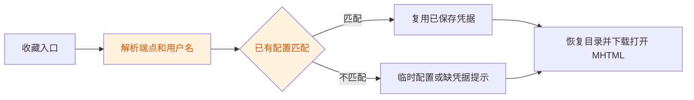
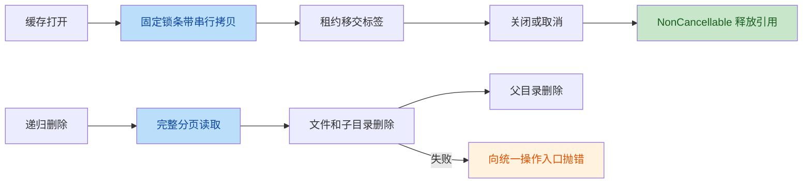

# 最新提交审查：a2672ac

## 审查结论

发现 1 个新增中严重性回归（R1），以及 1 个本次修复未闭合的中严重性旧风险（R2）。建议先修复 R1，并在同一解析器内闭合 R2。

| 编号 | 问题 | 建议 | 目标版本代码 |
|---|---|---|---|
| R1 | 中：重复解码与提前分隔损坏合法 FTP 用户名，新增账户匹配回归 | 从 encodedUserInfo 分隔，再用 Uri.decode 解码一次，匹配和临时配置共用解析结果 | [FilesNetworkOpenResolver.kt:48-50](file:///C:/Users/Player_X/AppData/Local/Temp/mhtml_review_a2672ac/app/src/main/java/html_reader/files/FilesNetworkOpenResolver.kt#L48-L50) |
| R2 | 中：FTP 用户名忽略大小写，仍复用错误账户身份；父版本已有风险 | FTP 用户名精确比较，不把主机大小写规则应用到账户 | [FilesNetworkOpenResolver.kt:55-56](file:///C:/Users/Player_X/AppData/Local/Temp/mhtml_review_a2672ac/app/src/main/java/html_reader/files/FilesNetworkOpenResolver.kt#L55-L56) |

代码链接指向隔离工作树中的目标版本，不指向尚未同步的本地开发分支。

## 范围与证据

- 已执行 `git fetch origin`，未 pull、merge、checkout 或修改开发分支。
- 目标：`a2672acd4069b4e61727b4b5abefb3500be27f82`。
- 父提交：`487d8232fb48406af4c5d0a125c6741dc31df4d4`。
- 提交说明：`fix: 修复审查发现的并发、缓存与边界问题`。
- 范围：17 个变更文件，重点审核生产 Kotlin、回归测试及调用链；不审查禁止文件。
- 作者意图：修复授权目录读改写竞态、缓存锁表增长与取消释放、递归删除分页和失败传播、网络身份匹配及列表截断、上传文件名边界、Worker 取消传播。
- 两个独立复核者均确认 R1/R2 存在；R2 严重性意见不同，最终按中严重性处理，不认定服务器认证绕过。

## 第一阶段：架构评估

### 概览

本次保持现有软拆分多模块结构及 Runtime 装配路径，不涉及数据库实体结构迁移。缓存修复位于 core-domain，标签管理位于 feature-reader，递归删除位于 feature-files，DAO 位于 core-data。维护 Worker 仍需区分生效的 App 路径与未启用的 Hilt 路径。

### 主要优点

1. 授权目录使用单消费者串行读改写，直接消除同实例内并发覆盖。
2. 缓存使用固定 64 个锁条带，锁表内存不再随文件数量无限增长；释放增加 NonCancellable 保护。
3. 递归删除先完整读取目录分页再处理删除，并传播失败，避免边删边分页跳项及忽略失败。
4. Worker 单独重抛 CancellationException；新增回归测试覆盖主要修复路径。

### 核心不足

1. 网络匹配新增用户名约束，但复用 Android 已解码 userInfo 后再做表单解码，破坏身份字符串。
2. 账户比较采用主机式大小写不敏感策略，没有区分 FTP 身份语义。
3. 网络匹配测试仅覆盖普通不同用户名，未覆盖 URI 编码边界和大小写身份；其余修复的选定测试通过不代表端到端验收完成。

### 业务变更链



### 技术变更链



## 第二阶段：问题详解

### R1：用户名重复解码与提前拆分（中，新增回归）

- 缺陷类型：身份解析错误、URI 防御性编程缺陷。
- 位置：`app/src/main/java/html_reader/files/FilesNetworkOpenResolver.kt` 新版第 48–50 行。
- 机制：Android `Uri.userInfo` 已百分号解码；`URLDecoder` 再次解释百分号，并把 `+` 变为空格。先对已解码内容按冒号拆分，也会把编码在用户名内的冒号误当密码分隔符。
- 真实链路：FilesFavoritePathBuilder 编码 FTP 用户名，FavoritesRepository 清除密码但保留编码用户名；FavoritesFragment 用解析结果选择保存配置，缺凭据时停止打开。
- 复现一：配置 username=`a+b`，收藏 `ftp://a%2Bb@host/private/`，期望 configId=7，实际 null，落入缺凭据路径。
- 复现二：配置 username=`a:b`，收藏 `ftp://a%3Ab@host/private/`，期望 configId=7，实际 null，临时分支错误识别 username=`a`、password=`b`。
- 父版本：同端点唯一正确配置会直接复用成功，因此本次新增用户名过滤引入上述回归。临时分支重复解码本身是旧缺陷，不全部归因于本次。

修改前：

```kotlin
val uriUsername = uri.userInfo
    ?.substringBefore(':')
    ?.let { runCatching { URLDecoder.decode(it, "UTF-8") }.getOrNull() }
```

建议修改后（示意，未实施）：

```kotlin
val encodedUserInfo = uri.encodedUserInfo
val uriUsername = encodedUserInfo
    ?.substringBefore(':')
    ?.let(Uri::decode)
val uriPassword = encodedUserInfo
    ?.substringAfter(':', "")
    ?.let(Uri::decode)
```

匹配与临时配置必须共用这组结果；不能仅修第 48–50 行而保留第 61–64 行另一套重复解码。非法输入不得被解释为“未指定用户名”并退回任意同端点账户。非 UTF-8 FTP 用户名兼容策略需结合既有字符集设置另行验证，不在本次实验中宣称覆盖。

### R2：FTP 大小写不同身份仍被合并（中，旧风险未闭合）

- 缺陷类型：账户身份匹配错误。
- 位置：同文件新版第 55–56 行。
- 机制：`firstOrNull` 加 `ignoreCase=true`，把 Alice 与 alice 当作同一账户，直接返回列表中的第一个配置；下游使用该配置的用户名和密码，没有重新校验收藏身份。
- 复现：配置列表 `[id=1, username=alice]`、`[id=2, username=Alice]`，收藏 `ftp://Alice@host/private/`，期望 2，实际 1。
- 后果：在区分用户名大小写的 FTP 服务上，打开失败或展示另一个已保存账户可见的内容；服务器仍按实际凭据授权，不属于认证绕过。
- 归属：父版本完全忽略用户名，本来就有该问题。本次修复缩小了误匹配范围，却未闭合大小写边界。

修改前：

```kotlin
it.username.equals(uriUsername, ignoreCase = true)
```

建议修改后（示意，未实施）：

```kotlin
when (protocol) {
    NetworkProtocol.FTP -> it.username == uriUsername
    NetworkProtocol.SMB -> it.username.equals(uriUsername, ignoreCase = true)
}
```

此示意仅修复有证据的 FTP 路径；SMB 域名、账户格式及无 userInfo 收藏的歧义不在本次实验覆盖范围，不据此判定 SMB 身份策略完全正确。

## 第三阶段：风险矩阵

| ID | 描述 | 维度分类 | 严重性 | 修复成本 |
|---|---|---|---|---|
| R1 | 合法编码用户名不能匹配正确配置，或被错误拆分 | 安全与防御性编程、Kotlin 可维护性 | 中，新增回归 | 低：统一解析并补边界测试 |
| R2 | FTP 大小写不同身份错误复用 | 安全与防御性编程、设计契约 | 中，旧风险残留 | 低：精确比较并补双账户测试 |

性能与资源维度未发现足以新增列出的确定性回归；系统架构维度保持既有装配方式。未将纯风格意见或无具体证据的推测计入问题。

## 第四阶段：改进路线

- P0：在发布该提交前修复 R1，采用 encodedUserInfo 单次解码；补 `+`、`:`、字面百分号及转义边界回归。
- P1：闭合 R2，并在隔离 FTP 服务中用两个仅大小写不同的账户验证收藏、目录恢复、下载打开链路。
- P1：合入本次临时复现实验的正式测试版本，分别保留“正确配置复用”和“临时配置解析”断言。
- P2：在批准范围内统一网络身份解析与协议比较策略，避免匹配和临时配置分支各自维护字符串规则；不扩展到 PDF、上传专项或备份契约重构。

## 验证记录

- 环境：Windows，JDK 17，目标提交隔离工作树；生产 Kotlin 编译通过。
- 选定原有测试：23 项通过，0 项失败。
- 临时审查复现测试：3 项运行，3 项失败，分别验证 R1 的两个案例及 R2。
- 合计：26 项运行，3 项失败；这些失败是额外实验，不是提交原有测试失败。
- `git diff a2672ac^ a2672ac --check` 通过。
- 未运行全量测试、设备端 MHTML 排版/手势、真实 SMB/FTP、Keystore 验收；不能用本轮测试替代这些验收。
- 临时实验首轮枚举名写错导致测试编译未通过，修正为 FavoriteType.FOLDER 后完成上述有效运行；该失误不归因于被审查提交。
- 无生产代码修改、无 APK、无修复提交、无推送。临时脚本/测试/构建产物均位于系统临时目录，开发分支只新增本报告。
