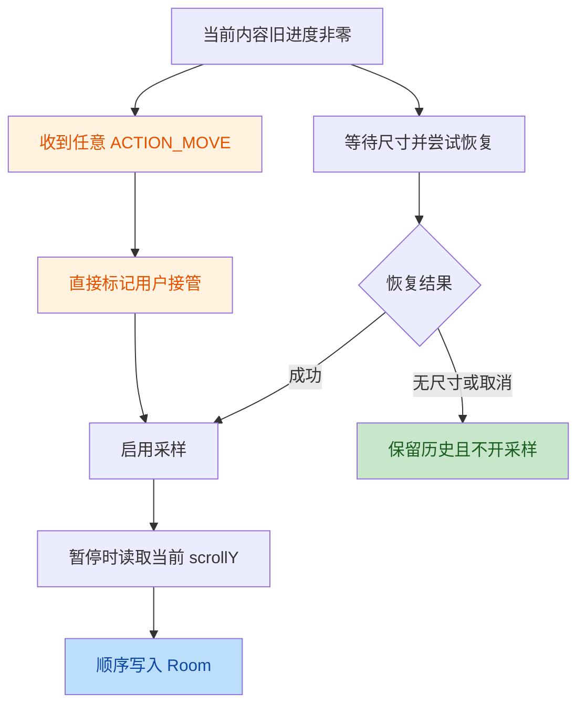

# 当前项目复核：MHTML 主线

## 结论与范围

- 基线：`b2c8fe1`，版本 `1.0.71 / 72`，叠加当前未提交 V03 工作区。
- 本轮只审查，不修改功能、不递增版本、不生成新 APK。未提交 V03 不代提交。
- 按此前用户确认，重点为本地及 SMB/FTP 下载打开 MHTML、缓存、标签、WebView 进度和相关 Files UI；不是全仓逐文件安全认证。PDF、上传专项、备份/收藏新契约不扩展。
- 发现 4 项：高严重度 3 项、中严重度 1 项。两名独立验证者均确认全部四项的成立路径。
- 上轮 R1 的“超时后 finally 无条件完成恢复”已修复，但任意 ACTION_MOVE 被当作主动接管仍可造成原进度丢失。不能把这次复核写成“R1 已完全闭合”。
- 缓存交接及并发预算分别是历史 F11/F10 的未闭合部分，不是 `b2c8fe1` 新引入。提前 EOF 也是原有代码缺陷。

| ID | 严重度 | 问题 | 最小证据位置 |
|---|---|---|---|
| Q1 | 高 | 轻触抖动即可取消恢复并放行顶部尾写 | `app/src/main/java/html_reader/ReaderFragment.kt:159-165` |
| Q2 | 高 | 拷贝完成到标签绑定之间失去缓存保护，可发布无文件的 Ready | `core/cache/CacheOpenManager.kt:130-132`；`core/reader/tab/DefaultReaderTabManager.kt:120-121,166-168` |
| Q3 | 高 | 不同 key 并发只检查落盘大小，没有未落盘容量预约 | `core/cache/CacheEvictor.kt:55-58`；`core/cache/CacheOpenManager.kt:85-96` |
| Q4 | 中 | 正常短 EOF 仍上报 100% 并创建 Ready 标签 | `core/cache/CacheOpenManager.kt:109-115,129` |

## 第一阶段：架构评价

### 概览

源码软拆分与运行时装配保持一致：`core/cache` 编入 core-domain，`core/reader` 编入 feature-reader，网络网关和 Fragment 位于 app。ReaderRuntime 持有 CacheOpenManager、TabCacheRegistry、ReaderViewModel 和应用级进度 Writer。SMB/FTP 先下载到中转文件，再作为 LocalFile 进入统一缓存。

本轮修复意图复核：以显式恢复结果替代 finally 成功信号，用有限等待和用户接管防止永远禁用采样；UI 用共享列宽统一四控件。方向合理，问题集中在“用户接管”的判定和已有缓存资源交接，而非配色或模块是否编译。




### 主要优点

1. 显式恢复结果、generation 校验、有限等待及取消传播，已消除原 R1 的无条件 finally 放行。
2. 应用级 Writer 持有不可变快照，按序写入；原子 UPSERT 避免尾写与创建历史行竞态。Fragment 销毁后不依赖已取消的 UI scope 写历史。
3. 网络下载使用临时文件替换，SMB context 超时实际接线；WebView 默认禁用 JavaScript，file 访问经过 canonical 根目录校验，敏感 URL 日志使用摘要。
4. 已有真实 Room 的 Robolectric 集成测试、布局几何测试和导航回归，且文档明确真实 Chromium/设备验证尚未完成。

### 核心不足

1. 缓存预算、文件完整性、在途保护、标签发布由不同对象分别管理，缺少贯穿打开事务的资源所有权。
2. `Flow<Result<CopyProgress>>` 只表达过程字节数，没有携带“已校验缓存文件及其保护租约”的完成结果；调用方靠存在性推定成功。
3. 阅读恢复将触摸事件近似为阅读意图，未使用 Android 的手势阈值；现有集成测试绕过了真实触摸监听器。
4. 测试覆盖偏顺序成功路径，先落盘再并发的测试无法验证尚未落盘的预约；Helper 测试不能替代资源交接时序测试。

## 第二阶段：问题明细

### Q1 高：轻触抖动覆盖旧阅读进度

**维度：** 状态管理、Kotlin 可维护性、防御式编程。**归属：** R1 未完全闭合；新增即时放行路径，但误判用户接管并非首次出现。

**机制：** ACTION_MOVE 不意味着已经超过 touchSlop，更不意味着发生了阅读滚动。当前代码不检查 down 坐标、位移、手势取消、内容是否可采样，任意 MOVE 都设置当前 generation 已接管。恢复流程随后不再定位，Tracker 的 stopAndFlush 直接读取当前位置，baseline 只过滤 scroll 回调，不能拦截尾写。

**成立条件：** 旧进度非零、尚未成功恢复、收到不足触发滚动的 MOVE，暂停时尺寸有效且 scrollY 仍为零。若尺寸始终无效且无快照，不会写入；真正有意拖动后保存当前位置是应保留的功能。

修复前：

```kotlin
if (event.actionMasked == MotionEvent.ACTION_MOVE) {
    webRestoreInteractionGeneration = webContentGeneration
    // USER_TOOK_CONTROL -> enableSampling()
}
```

修复后建议的最小手势判定核心，需接入 down/cancel/up 生命周期：

```kotlin
val dx = event.x - downX
val dy = event.y - downY
val slop = ViewConfiguration.get(context).scaledTouchSlop.toFloat()
val intentionalDrag = dx * dx + dy * dy > slop * slop
if (intentionalDrag && readWebViewMetrics().maxScrollY != null) {
    markCurrentContentTakenOver()
}
```

这里的 `markCurrentContentTakenOver` 是拟提取函数，不是当前已有 API。down 坐标必须绑定当前 generation，CANCEL/UP 清除；区分“停止自动定位”和“允许保存有效新位置”，不能为拦截轻触而取消真正拖动、缩放或无障碍操作。

**验收：** 小于 slop 的 down/move/up、长按抖动保留 0.6；有效拖动后可保存新位置；零尺寸、切 tab、后台及取消事件不解锁其他代次。补测试须调用生产触摸监听器，而非直接传 USER_TOOK_CONTROL。

### Q2 高：缓存保护交接空窗

**维度：** 架构、协程并发、资源生命周期。**归属：** 历史 F11/T10 遗留。

**机制：** CacheOpenManager 在 Flow 完成时删除 inFlight；TabManager 在检查缓存存在后挂起查询历史，随后才 bind。此时另一个背景打开可依法淘汰该缓存。历史查询返回后不再检查文件，仍发布 Ready。仅在建 tab 前重查 exists 不能根治，因为检查与发布之间仍可被淘汰。

修复前：

```kotlin
// CacheOpenManager finally:
inFlightKeys.remove(cacheKey)
// DefaultReaderTabManager:
val hist = historyRepo.getByPath(historyKey)
// publish tabs/current ...
tabCacheRegistry.bind(tabId, contentType.name.lowercase(), cacheKey)
emit(OpenState.Ready(tab))
```

修复后目标契约（拟新增 API，非可直接粘贴的局部替换）：

```kotlin
val lease = cacheStore.openAndAcquire(request)
try {
    val position = historyRepo.getByPath(historyKey)
    val tab = tabStore.attachLeaseAndPublish(request, position, lease)
    emit(OpenState.Ready(tab))
} finally {
    lease.releaseIfNotTransferred()
}
```

租约从写入/复用开始持续到标签接管；`attachLeaseAndPublish` 必须在状态同步区内先转移所有权再发布。duplicate、取消、历史读取失败都释放未移交租约。最后一个引用释放才允许删除，所有淘汰路径使用同一保护来源，禁止只在 Fragment 补一个锁。

**验收：** A 完成复制、挂起历史；B 腾空间时必须看到 A 的保护；A 最终 Ready 必有文件。再覆盖发布即关闭、重复打开、取消，以及实际 Runtime 装配的共享保护对象。

### Q3 高：并发容量检查没有预约

**维度：** 性能与资源消耗、防御式编程。**归属：** 历史 F10/T09 遗留，本项只确认并发预约缺口。

**机制：** 每个 key 有自己的 Mutex；不同 key 的 makeRoomFor 只扫描当下文件大小。空缓存预算 200，A/B 各 150，均在首块落盘前通过检查，最终占用 300。inFlightKeys 是禁止删除集合，不表示预留字节数。生产预算为 2 GiB，200/150 是等比例的确定性测试模型。

FilesFragment 的 openFileInBackground 每次独立 launch，可并发进入；网络下载自身的操作锁不会等后台缓存复制结束才释放，因此不能作为全局容量锁。

修复前：

```kotlin
val total = collectCacheItems().sumOf { it.size }
if (total <= maxBytes - requiredBytes) return EvictionResult.READY
```

修复后目标契约（拟新增 API）：

```kotlin
val reservation = budget.reserve(cacheKey, expectedBytes)
try {
    copyWithBudget(reservation)
    reservation.commit(actualBytes)
} finally {
    reservation.releaseRemaining()
}
```

reserve 的“检查、淘汰、登记预约”必须原子化；盘上已写字节加预约剩余字节不能双计，也不能遗漏。未知长度按块扩容并在写入前检查；取消/失败释放未用预约。仅给 makeRoomFor 加短时 Mutex 仍会在两次写入之间放行两份预约，因此不够。

**验收：** 两个 150 在预算 200 下首块前同时预约，最多一个获准；准确边界、未知长度增长、取消、磁盘写失败、活跃缓存占满均有确定性断言。FTP/SMB 中转区的额外占用不在本项“app_cache 预算”证明范围内，不宣称修此项就控制了应用所有磁盘空间。

### Q4 中：正常短 EOF 被当作完整成功

**维度：** 异常处理与完整性校验、Kotlin 可维护性。**归属：** 历史实现缺陷。

**机制：** TabManager 先采样本地文件长度；源在打开输入流前被截短或拷贝期间原地截短时，read 可以正常返回 EOF。代码不比较实际 copied 和预计 totalBytes，最后伪造 total/total。调用方仅检查缓存存在，仍发 Ready。此项不声称原子替换已打开的文件描述符一定导致短读，也不把 CacheOpenManager 描述为直接读 FTP/SMB 网络流。

修复前：

```kotlin
if (read == -1) break
// ...
emit(Result.success(CopyProgress(totalBytes, totalBytes)))
```

修复后应在关闭输出并提交缓存前校验：

```kotlin
if (expectedBytes != null && copied != expectedBytes) {
    throw EOFException("Source length changed while copying")
}
emit(Result.success(CopyProgress(copied, expectedBytes ?: copied)))
```

`expectedBytes` 应以 `Long?` 区分未知长度和合法空文件；不要把所有 0 当未知。失败走临时文件清理，只有校验通过才发布最终缓存及 Ready。建议同步比较可用的源版本元数据，但长度检查本身不能证明 MIME/MHTML 语义完整或防止同长度内容变化。

**验收：** 预计 100、实际 60 的正常 EOF 必须 Error、无新 Ready、无可复用半成品；100/100 成功；真实空文件与未知长度分别测试。不假设下次重开一定会纠正，已有同版本标签会先被直接复用。

## 第三阶段：风险矩阵

| ID | 影响 | 维度 | 严重度 | 修复成本 | 证据置信度 |
|---|---|---|---|---|---|
| Q1 | 轻触后旧位置被顶部值覆盖 | 架构/Kotlin/防御 | 高 | S-M：手势状态与回归 | 高，2/2 独立确认 |
| Q2 | 并发打开后空白或文件丢失提示，Ready 不可信 | 架构/并发/资源 | 高 | L：租约、原子发布、装配 | 高，2/2 独立确认 |
| Q3 | 缓存突破配置容量、并发大文件挤占存储 | 性能/资源/防御 | 高 | L：全局预约与失败释放 | 高，2/2 独立确认 |
| Q4 | 截短 MHTML 被宣布完整打开 | 防御/Kotlin | 中 | M：完成结果、临时提交、测试 | 高，2/2 独立确认 |

严重度与排期不同：不把三项高严重度全部推成“立即大规模重构”。本轮未确认新的远程代码执行或凭据泄漏漏洞，也不据此认证整个应用安全。

## 第四阶段：改进路线

### P0：立即闭合进度缺口

1. Q1：补生产触摸监听器的反例测试，再实现有阈值且绑定内容代次的接管判定。
2. 保留上轮恢复失败保护、应用级顺序 Writer、既有导航锁与 UI 紧凑布局，避免借修复重写整个 ReaderFragment。
3. 真实设备验收轻触、拖动、缩放、长按图片、返回/后台、键盘与 TalkBack；Robolectric 不能替代真实 Chromium 手势分发。

### P1：缓存正确性两批推进

1. 先 Q4：建立已知/未知长度及明确完成结果，校验后提交，拒绝正常短 EOF。
2. Q2/Q3 联合设计、分提交验证：同一个缓存协调对象维护租约与容量预约，Runtime 只装配一个实例；明确成功转移、失败释放和最终删除者。
3. 每批验收包含受控并发屏障，不用 Thread.sleep 猜测时序；不能只写单线程 Helper 测试。
4. 不在该批顺手启用 Hilt、改备份/收藏契约、扩展 PDF/上传专项。若要求扩大范围，另行确认。

### P2：MHTML 主线架构演进

1. 将缓存过程事件与成功句柄分开，Ready 只消费带有效租约的完整缓存结果。
2. 阅读状态逐步采用单一不可变快照发布 tab 列表及当前 tab，减少 Fragment 拼接多路状态；实施前补回归，不能仅凭本轮静态评价宣布现有双 Flow 必然有新 bug。
3. 添加本地/SMB/FTP 各一条设备端打开、恢复、离页链路；记录首屏耗时、峰值磁盘、重复复制量，拿数据决定优化，不预先删功能或改缓存复用策略。

## 验证与限制

- 重新执行 `:core-base:testDebugUnitTest :app:testDebugUnitTest --rerun-tasks` 成功，147 tasks 全部执行，耗时约 3m20s。
- 基线 253 项：app 230（2 跳过），core-base 23；251 通过，0 失败/错误。包含当前未提交 V03，不是纯 HEAD 的隔离结果。
- 缺陷证据实验独立置于系统临时目录，通过 Gradle init script 注入测试源，不修改仓库生产代码或原测试文件。四项全部复现，结果如下。
- adb 无设备。未进行真实 MHTML/SMB/FTP 服务器交互、WebView 渲染、截图或触摸端到端验收。
- Files 四控件原有几何、导航与列表比例测试通过；没有将 48dp、14sp 或配色当作审查缺陷。未以空路径的几何测试证明所有长路径、输入法及字体渲染都已验收。
- 本轮查阅未提交 V03 的主线相关游标迁移/本地 rename 差异，未发现需新增的确定问题；未重新做整个备份事务专项审计。

### 受控实验结果

| ID | 实验方法 | 实际观察 |
|---|---|---|
| Q1 | 调用 Fragment 安装的生产 OnTouchListener，送入 down、1px MOVE、up；真实 Tracker/Writer/Room，scale 与尺寸由测试 WebView 提供 | 没有 scroll，scrollY=0；原 history 0.6 被尾写为 0.0 |
| Q2 | A 拷贝后，在代理 HistoryDao.getByPath 用 CompletableDeferred 暂停；B 用同一 opener 腾空间；恢复 A | A 返回 Ready、key 已 bind，但 cacheFile.exists=false |
| Q3 | 两个不同 key 在 openInputStream 入口互等，保证预算检查都发生在首块写入前 | 预算 200，两份 150 都成功，缓存实际 300 |
| Q4 | 源文件先有 100 字节，openInputStream 时原地截短为 60，继续走真实 LocalFileSystem 与 TabManager | 缓存 60 字节，最后 Copying=100/100，仍有 Ready |

四项 probe 运行结果为 4/4 通过、0 跳过。这些断言专门确认当前错误行为，**不是修复验收全绿**。Q1 是生产监听器调用级实验，没有模拟真实 Chromium 对完整触摸序列的分发；其证据足以确认任意 MOVE 放行和数据库覆盖，但不应伪称真机复现。

临时实验目录：`C:\Users\Player_X\AppData\Local\Temp\mhtml-review-20261015`。

- 源文件：`ReviewEvidenceTest.kt`，4 个方法与上表逐项对应。
- 注入脚本：`review.init.gradle`。
- 已归档结果：`evidence.xml`；Android 插件实际将 XML 写到了 app 的常规测试目录，归档后重新运行普通测试以恢复常规报告。
- 实验命令：JDK 17 下执行 `.\gradlew.bat -I C:\Users\Player_X\AppData\Local\Temp\mhtml-review-20261015\review.init.gradle :app:testDebugUnitTest --tests '*ReviewEvidenceTest'`。
- 临时文件不纳入 Git；后续修复应将相反的期望断言纳入对应正式回归，而不是把 probe 的“错误行为成立”断言直接当作验收。
