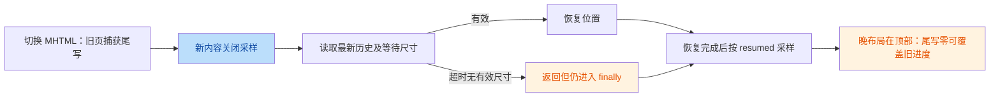

# MHTML 修复提交复核

> 用户确认范围：`dea4a47..7a9aedc` 四个提交。应用 1.0.70 / 71，Room v4。
> 不重复审查未提交 V03，不修改或提交其文件。后续仍仅本地及 SMB/FTP 下载打开 MHTML，PDF/上传专项暂缓。
> 本轮仅审查及验证，不修改生产代码、不改版本、不生成 APK。

## 1. 核心发现

| No. | Issue Title | Suggestion | Code Link |
|---|---|---|---|
| R1 / 高 | 恢复失败仍完成采样门，尾写可覆盖旧阅读位置 | 区分恢复成功、用户接管和尺寸超时；超时不标完成、不开放自动尾写，允许当前内容受控重试 | [ReaderFragment.kt:L585-L588](file:///C:/Users/Player_X/Documents/Tare/mhtml_reader/app/src/main/java/html_reader/ReaderFragment.kt#L585-L588) |

R1 是 B03 新实现尚未闭合的失败路径，不代表 B01/B02 修复失败。两名独立验证者均确认。

## 2. Phase 1：架构评价

作者意图：脱敏日志，保持操作期间目录导航状态，并补齐 MHTML 尾写、顺序持久化、页面恢复及前后台采样生命周期。

优点：

- B01 仅保留 scheme/安全 host，userinfo、path、query、fragment、data 内容不进入拦截日志。
- B02 显式保存操作禁用理由；Up、系统返回和目录点击共享守卫，阻止时返回“已处理”符合 MainActivity。
- B03 writer 只接收数据、应用作用域串行落库，UPSERT 解决历史行尚未创建时尾写丢失。
- 生命周期补修明确区分恢复完成与 Fragment resumed，避免单纯重挂 listener 就提前采样。

不足：

- 恢复“退出”仍被当成恢复“成功”，失败分支解除安全门。
- generation gate 一旦 claim，尺寸失败后也不允许同代次重试。
- 测试验证 helper 较充分，但缺少 Fragment 的恢复超时→晚布局→尾写→数据库端到端回归。



## 3. Phase 2：机制与修复契约

### R1：失败恢复开放采样

- 类型：状态机/防御编程/阅读状态一致性。
- 条件：历史进度非零；整个尺寸等待窗口都无有效 metrics；请求仍为当前内容；之后尺寸有效但页面仍在顶部，发生暂停/离页尾写。
- `awaitStableMetrics` 默认24次、50ms间隔，均无有效尺寸时返回 null；调用方 L575 `?: return` 仍进入 finally。
- L586 标记恢复完成；前台立即开放采样，后台则在下一次 resume 开放。
- gate 已 claim，后续同代次 pageFinished 不重试。tracker 的最终快照读取实际 scrollY，即使没有滚动事件也能生成0；HistoryDao UPSERT覆盖旧 progress。
- 不泛化为“所有慢图片都丢进度”：窗口内有有效尺寸时不属于此缺陷；尺寸超时后用户主动阅读滚动到新位置的行为应另行处理。

当前：

```kotlin
val stableMetrics = awaitStableMetrics(...) ?: return
// ...
finally {
    if (isCurrent(...) && samplingState.onRestoreCompleted(generation)) {
        tracker.enableSampling()
    }
}
```

修复契约示例，需遵守实际项目接口：

```kotlin
when (val result = restoreCurrentContent(request)) {
    is RestoreOutcome.Applied -> completeRestoration(request)
    RestoreOutcome.UserTookControl -> activateUserSampling(request)
    RestoreOutcome.DimensionsUnavailable -> scheduleBoundedRetry(request)
    RestoreOutcome.Superseded -> Unit
}
// finally 只释放本次任务资源，不把所有退出升级为成功。
```

要求：

1. 尺寸超时保留原历史与关闭的自动采样门，不做顶部尾写；用户主动接管与超时必须区分。
2. 可通过尺寸/布局就绪或有限重试重新恢复当前内容；gate区分in-flight与completed。不能无限poll、每次pageFinished重拉用户。
3. 重试检查tab、generation、URL、view；旧job不能打开新内容采样，监听与callback在离页解绑。
4. 用户真正开始阅读时允许接管，不用“关闭采样直到永远”来保住历史。单纯触摸取消恢复的现有策略若要改变，先明确交互测试。
5. 不改Room schema、PDF或上传，不用NonCancellable包整页恢复。

测试必须覆盖：

- 历史0.6；超过24次 metrics 无效；恢复结束/暂停时原0.6保留，onResume不误开放失败内容。
- 尺寸晚到→当前代次成功重试→正确offset→采样启用；仅触发重复pageFinished也不丢原位置。
- 超时期间A→B→A及view销毁；旧重试不定位新页。
- 用户接管、恢复成功后pause/resume、短页0范围保持既有行为。
- Fragment/controller 集成到实际HistoryDao，不仅单独测试SamplingState或数学helper。

## 4. Phase 3：风险矩阵

| ID | 维度 | 严重度 | 成本 | 复核判定 |
|---|---|---|---|---|
| R1 | 状态设计、协程、数据一致性 | 高 | 中 | B03 未通过最终代码验收 |
| B01 | URL日志防御 | 无新增确认缺陷 | 无 | 代码及已有回归方向通过；设备logcat待验 |
| B02 | 操作态与导航 | 无新增确认缺陷 | 无 | 原U1已闭合；实际网络设备待验 |

### 未列为确定问题

fallback reload 在恢复gate已claim后未更新generation，是值得补状态回归的候选。但迟到fallback的完整设备触发序列未证明：
`MeasuringWebView` 读取的是 horizontal scroll range，不是视觉正文宽度，不能默认它会低于viewport的72%。验证者1确认代码条件路径，验证者2指出该前提不足。
因此不将它作为确定新增缺陷，不声称“永久关闭采样”；onResume可重新启用。后续真实WebView证据确认后再立项，不扩大此次修复范围。

## 5. Phase 4：后续建议

- P0：下一轮先单独闭合R1，允许文件为ReaderFragment的Web恢复接线、WebViewProgressRestorer/SamplingState及相关测试。需要改变gate契约时一并补回归，不重构整个阅读器。
- P1：R1复核后补MHTML真实WebView设备验收：非零进度重开、500ms内离页、旋转、A→B→A、迟到图片/尺寸、前后台切换、本地与网络下载打开。
- P2：继续原B04 MHTML性能证据采集，先测冷/热打开和多标签耗时/内存再定优化；不沿旧计划自动推进PDF、上传、备份、收藏或DI。
- 本轮不代执行功能修复；用户选择修复方式后再实施或交给原执行者。

## 6. 验证与交付

- JDK17 实际重跑 `:core-base:testDebugUnitTest :app:testDebugUnitTest --rerun-tasks`，BUILD SUCCESSFUL，147任务全部执行，约2m52s。
- XML计数：app222 + core-base23 = **245项，243通过、2跳过、0失败、0错误**；两项跳过仍为本地符号链接能力测试。
- 现有单测没有覆盖R1的Fragment失败恢复端到端链；全绿不能关闭此项。
工作区仍含未提交V03，任何全套测试为共享工作区验证，不是四个提交隔离验收。
设备adb无连接；未执行assemble、lint或connectedAndroidTest，未声称实际WebView可视化验收。
