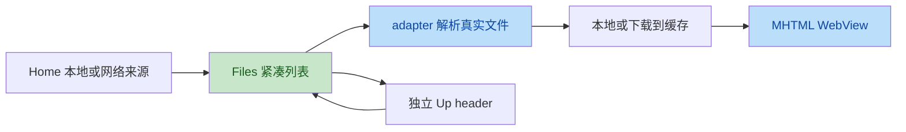

# 新工作复核与 MHTML 浏览主线计划

> 审查基线：`497cfbe`，应用 1.0.66 / 67；范围 `35792ac..497cfbe` 加当前未提交 V03。
> 用户确认：后续集中本地及 SMB/FTP 下载打开 MHTML；本轮只审查，下一份计划纳入全部三个已确认问题。
> 用户未要求删除任何功能。PDF、上传专项不再列入后续主动执行队列；旧功能和已提交修复保留。
> 本文件覆盖旧计划的优先顺序，不把历史 PDF/上传任务作为下一轮入口；各卡实施状态以本文顶部及对应执行记录为准。
> **执行状态（2026-10-14）**：B01、B02 已完成，分别见 `reviews/mhtml_security_execution_2026-10-14.md` 与 `reviews/files_navigation_execution_2026-10-14.md`；B03 尚未开始。

## 1. 结论

| 范围 | 代码复核判定 | 尚缺证据 |
|---|---|---|
| 497cfbe / Home 密度 | 实际行测高、observer 清理、响应式按钮方向可接受 | 真机内外滚动、大字体、实际前后截图 |
| 497cfbe / Files 紧凑顶栏 | header 先于 adapter，点击/长按取 adapter item，空态和旧位置偏移正确 | U1 操作态回归未关闭，网络根及旋转设备验证 |
| 8ec0279 / PDF | 已补等待旧 load/render 和 Bitmap 创建时登记；原 S6/R3 主要缺口代码方向通过 | Fragment 全切换集成及真实 PDF；不安排后续 PDF 专项 |
| 7eee5cc / 网络 | CIFSContext 超时实际字段已接线，共享 context 和资源 use；下载入口有 factory 测试 | 真实 SMB/FTP 下载认证、取消及缓存更新 |
| 7eee5cc / 上传 | 已加部分写入持久状态与回页提示 | 本轮没有发现需立刻回退的新增问题；不安排上传后续专项 |
| V03 / 未提交 | keyset、准备阶段移至事务前、循环取消、NOFOLLOW_LINKS 冲突方向通过 | 尚未提交；两项 symlink 测试被跳过，不能完整验收 |

没有发现本轮 header 把首个真实文件当成 Up 的索引错误。没有把预期的间距/配色改动当作缺陷。SMB rename 的类型化 Conflict 仍未接线，是旧卡剩余事项，不因这次网络提交自动完成；属于管理能力，暂不排专项。

### 测试与 APK

- JDK17 重跑 `:core-base:testDebugUnitTest :app:testDebugUnitTest --rerun-tasks`：BUILD SUCCESSFUL，147 tasks executed，约 2m22s。
- app191 + core-base23 = **214 项，其中212通过、2跳过、0失败、0错误**。
- 跳过项为 LocalFileSystemRenameTest 的目标 symlink / dangling symlink 冲突测试，主机缺乏创建链接能力。
- 上述是当前共享工作区结果，包含未提交 V03；不是每个提交隔离验收。
- UI 执行记录已诚实声明 1.0.66 APK 混入未提交 V03。不得将该 APK 描述为只由 497cfbe 可重现。
- 本轮没有重新 assemble、lint、设备测试；使用本机 SDK 的 adb 绝对路径确认没有连接设备。命令未在 PATH 不代表机器没有 adb。
- 两名独立验证者均确认 U1/M1/M2 及下述措辞边界；未做运行时复现，不声称已观察到设备泄漏或进度归零。

## 2. Phase 1：架构评价

作者意图是关闭上一轮并发/资源缺口、让网络超时真实生效，并按用户需求扩大浏览区域。继续使用 View/XML、Runtime 和软拆分，无大范围迁移。

优点：

- ListView header 不污染 BrowserEntry，业务项索引由 adapter 解析。
- 滚动恢复增加 session/path/视图/代次检查，旧记录不会每次累加偏移。
- Home 高度观察者有注销与 callback 清理，测量限定行数。
- V03 保留 CAS 和兼容导入语义，取消检查在清库前准备及写循环都有覆盖。

不足：

- Up 刷新状态没有合并操作锁，显示状态和行为约束脱节。
- MHTML 历史数据已保存到模型，但 WebView 没有消费并恢复，尾写还会取消。
- 文档资源日志仍有秘密泄露边界。
- 共享工作区的 APK/测试与提交范围不同，必须分开描述代码与二进制验收。



## 3. Phase 2：确认问题

| No. | Issue Title | Suggestion | Code Link |
|---|---|---|---|
| M2 高 | MHTML 被拦截资源/导航完整 URL 直接落日志 | 使用不含 userinfo、query、fragment 的安全摘要，不只删密码 | [资源日志 L40](file:///C:/Users/Player_X/Documents/Tare/mhtml_reader/core/reader/web/BlockingResourceWebViewClient.kt#L40)、[导航日志 L71](file:///C:/Users/Player_X/Documents/Tare/mhtml_reader/core/reader/web/BlockingResourceWebViewClient.kt#L71) |
| M1 中 | MHTML 尾次阅读进度丢失，重建后无历史驱动的滚动恢复 | 捕获快照并有序持久化，页面稳定后幂等恢复，抑制恢复期间回写 | [stopTracking L43-L45](file:///C:/Users/Player_X/Documents/Tare/mhtml_reader/core/reader/web/WebViewProgressTracker.kt#L43-L45)、[Web 加载 L454-L456](file:///C:/Users/Player_X/Documents/Tare/mhtml_reader/app/src/main/java/html_reader/ReaderFragment.kt#L454-L456) |
| U1 中 | 操作期间禁用的 Up 被目录刷新重新启用 | 合并当前操作态与可向上态，入口统一检查，不能刷新默认 true | [默认参数 L549](file:///C:/Users/Player_X/Documents/Tare/mhtml_reader/app/src/main/java/html_reader/FilesFragment.kt#L549)、[赋值 L564](file:///C:/Users/Player_X/Documents/Tare/mhtml_reader/app/src/main/java/html_reader/FilesFragment.kt#L564)、[调用 L778](file:///C:/Users/Player_X/Documents/Tare/mhtml_reader/app/src/main/java/html_reader/FilesFragment.kt#L778) |

### M2：安全/防御，既有问题，不是本次新回归

MHTML 外部子资源进入拦截回调后，userinfo 密码或 query token 原样进 Log.d；非 HTTP(S) 被拒导航也有该问题。HTTP(S) 导航提前返回，不经过导航日志，不能泛化成所有外链均记录。风险不等于网络配置密码自动泄漏，读取日志也需要相应权限；不声称已公网外泄。

```kotlin
// Before
Log.d(tag, "blocked_resource fileType=$fileType url=$url")
// After: 示例，helper 对畸形 URL 返回常量；不保留 path/query/userinfo
Log.d(tag, "blocked_resource fileType=$fileType target=${safeTargetSummary(url)}")
```

安全摘要最多记录 scheme 与验证后的 host，不日志 URL、path、data内容。`UrlCredentialSanitizer.sanitizeText` 仅删 userinfo 密码，不足以清除 query token；不要凭此宣布修复。不要增加网络请求、放宽拦截、启用 JavaScript。

### M1：状态/协程，既有问题

最后滚动不足500ms就切tab/暂停/销毁，stopTracking取消pending而无flush。已落库数据不因此丢失；同一存活WebView同URL可保留滚动，不能说每次返回必回顶部。新建WebView或跨文档加载没有应用层历史恢复。Tab.lastKnownProgress是创建时快照，直接读它不保证最新。

```kotlin
// Before
fun stopTracking() {
    job?.cancel()
    webView.setOnScrollChangeListener(null)
}
// After: 契约示意，不能将 UI/WebView 带进持久化任务
val snapshot = tracker.stopAndSnapshot()
progressWriter.enqueue(snapshot) // 捕获 source、内容代次和序号；同 source 有序
```

恢复需读取最新历史/内存快照，核验当前tab、内容代次与目标URL；页面有有效尺寸后计算offset。恢复滚动/首次加载产生的0事件不能覆盖历史；旧快照不得晚到覆盖较新快照。离页保存只持有不可变数据，不捕获已销毁View。不能用NonCancellable包整页业务；不承诺强杀进程时一定保存最后像素。

### U1：架构/状态，497cfbe 新回归的限定部分

本地/SMB操作禁用Up后，目录点击仍可触发加载；updateCurrentDirLabel/prepareRemoteBrowse以默认true刷新，非根目录Up再次启用。无刷新时仍禁用，根目录仍不可Up。系统Back无操作检查、目录项未受锁保护是旧问题；新回归仅是刷新覆盖禁用状态。

```kotlin
// Before
actionUpButton.isEnabled = operationEnabled && canNavigateUp
// After: 示意，需要合并现有加载/权限禁用理由，而不是删原参数
actionUpButton.isEnabled = operationEnabled && !operationRunning && canNavigateUp
```

这不能证明并发写入或文件损坏，下载已捕获原目标；不得把问题升为错下载。行为策略为操作中保持原禁用承诺：Up和系统返回的目录上行共享检查，显示刷新不清掉禁用理由。不因此开发上传专项。


## 4. Phase 3：风险矩阵

| ID | 维度 | 严重度 | 修复成本 | 性质 | 用户选择 |
|---|---|---|---|---|---|
| M2 | 安全、日志防御 | 高 | 低 | 原 F14 部分边界 | 纳入 |
| M1 | 状态设计、协程、阅读体验 | 中 | 中 | 原 T04 未闭合 | 纳入 |
| U1 | UI状态、导航一致性 | 中 | 低 | 新增状态回归 | 纳入 |

本轮没有确认 V03 新增生产缺陷；25ms真实时间的大输入取消测试不能精确证明取消发生在校验/规划而非decode，所以补充阶段闸门测试属于证据完善，不把它误报成生产取消失效。

## 5. Phase 4：执行卡

用户已选择全部三项。以下按同一浏览主线内风险给出建议顺序，不擅自扩大 feature 范围。

### P0 / B01：安全日志（M2）- 已完成

- 允许：BlockingResourceWebViewClient、必要安全摘要helper、相关tests；helper在`core/reader/web`归feature-reader，跨层复用再明确模块，不重构网络栈。
- 先写ShadowLog失败测试：HTTPS user:secret@host/path?token=secret#secret资源、非HTTP导航、畸形URL、data payload、不可信host控制字符。
- 修复两处日志并核对MHTML加载fallback诊断；保留场景/类型/原因，秘密不得进入任何测试期日志。
- 原拦截安全测试全部保留；不得把放行网络、开启JS或删日志能力当作修法。

### P1 / B02：浏览导航状态（U1）- 已完成

- 允许：FilesFragment和必要小型状态helper、FilesCompactLayoutTest；remote controller仅必要UI状态通知，不改传输/上传策略。
- 先测试setOperationButtonsEnabled(false) → updateCurrentDirLabel/prepareRemoteBrowse → Up仍禁用。
- 增加操作中目录上行入口检查；系统Back按MainActivity既有契约处理，不能返回false后意外触发更上层导航。先核对调用方再决定“已处理”返回语义。
- 完成/取消后再恢复可向上计算；根/网络无配置仍禁用；header offset、搜索排序、滚动恢复不变。
- 不清空用户目录、不断开操作、不加入新网络管理功能。

### P1 / B03：MHTML进度闭环（M1）

- 允许：WebViewProgressTracker、ReaderFragment的Web加载/暂停/销毁接线、小型进度writer/state helper、HistoryRepository必要方法、tests。保持Room v4；不改PDF渲染任务或上传。
- 先可控dispatcher测试滚动后<500ms离页最终保存、连续事件节流、旧快照不覆盖新快照、取消不触碰旧View。
- 恢复测试：进度0/0.5/1、短页、缩放、图像迟到改变contentHeight、重复onPageFinished、快速A→B→A、旋转、同URL不重载。
- 恢复阶段暂停进度采样，待尺寸有效后一次恢复；有限重试/布局监听有解绑，不无限poll，不自动把真实用户滚动拉回旧点。
- 页面切换前先捕获旧来源快照，新历史读取完成后再次核验tab/代次。writer有明确应用/阅读域生命周期，只接收数据，序列化同source写入。
- 网络下载打开当前以本地中转路径入reader；先保持该身份契约，不在此卡偷偷设计远端收藏/历史identity。网络重下后身份/版本稳定性作为B04审查对象。
- 修改后实测MHTML图片、布局fallback和离线安全；不能只用fake宣称真实WebView验收。

### P2 / B04：仅审查和采集 MHTML 性能证据

先研究本地/SMB/FTP“目录 → 下载 → cache copy → tab → WebView”耗时和内存，不先写未经证据的优化。
分开冷开/热开、大图片/大档案、多tab、慢网络；采集阶段耗时与帧阻塞，不记录凭据或文档正文。
关注缓存容量/lease/活跃tab、重复拷贝、远端版本更新、FTP编码代次、本地大目录主线程过滤。每个发现先证实，再提供任务；不自动接线 N05、备份或收藏重构。

### 明确暂缓

PDF所有专项、FTP/SMB上传增强、SMB改名/删除增强、备份扩展、全局DI迁移与未接线功能均暂缓。已提交代码不回退，未提交V03由其执行者单独收尾/提交，不替他提交。
网络配置/会话引用若直接阻断MHTML下载打开，可提出最小修复并标明因果；涉及备份/收藏新契约先问用户，不能沿旧N05卡默认实施。

## 6. 交付规范

- 执行前核对最新git/sourceSets/版本，保护未提交V03。只做一张卡；允许文件不够先问。
- 每项先失败测试，再改生产；全套单测 + JDK17 assembleDebug；功能改动递增实际版本并交付APK。
- APK要从对应干净提交或明确隔离构建产生。共享工作区混入改动时记录文件/commit差异，不称可由UI提交独立重现。
- 无设备不写“全部验收”；B03必须列真实WebView待验项，跳过测试单列。纯文档不改版本/不生成APK。

```powershell
$env:JAVA_HOME = "C:\Program Files\Java\jdk-17"
$env:Path = "$env:JAVA_HOME\bin;$env:Path"
.\gradlew.bat :core-base:testDebugUnitTest :app:testDebugUnitTest
.\gradlew.bat :app:assembleDebug
```

```text
先读CLAUDE.md与reviews/mhtml_review_plan_2026-10-14.md。
后续主线仅本地及SMB/FTP下载打开MHTML，本轮执行B01安全日志。
不得自动执行PDF、上传、备份/收藏扩展或旧N05卡；不删除已有功能。
保护未提交V03，只暂存自己修改。安全摘要不能只删userinfo密码而保留token。
补失败日志测试与原拦截回归，实测全套/构建，功能版本按当前值递增。
提交、APK、工作区混入项及设备待验如实记录；扩大feature优先级先问用户。
```
