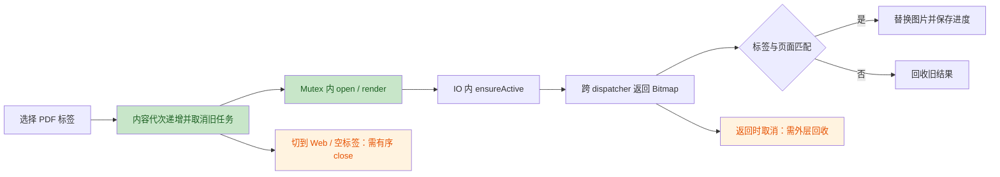
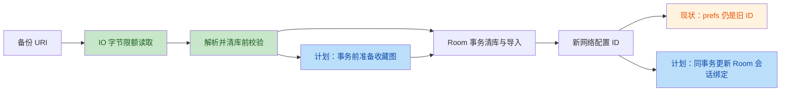

# mhtml_reader 执行复核与下一阶段计划

> 审查日期：2026-10-12。交接对象：较低阶 LLM；高复杂度任务必须经过高阶复核。
> 范围：`69f1cfd..9a1a0c2`，含计划外下载复用、缓存错误和名称去重改动。
> 当前生产基线：`9a1a0c2`，应用 `1.0.54 / 55`，Room v4。
> 本轮只审查、运行测试、修改文档；未修复生产代码，未递增版本，未生成 APK。
> 本文覆盖旧计划的任务状态和执行顺序；其余任务卡继续有效。

## 0. 先看结论

1. 确认六项问题：R1 是新增回归；R2 是错误类型接线遗漏；R3–R6 是既有任务尚未闭合的资源或防御边界。
2. 实际重跑 app 120 项、core-base 20 项，全通过，失败/错误/跳过均为 0。这不是 T02/T03 的真实 PDF 验收证据。
3. 下一轮只执行 N01，先阻止不可靠下载复用；随后 N02、N03、N04。
4. T06B 推荐“统一到已有 Room 引用字段，再事务内重映射”。这是设计建议，不是已接线功能；不能交给低阶模型自由设计。
5. 禁读 `bundle_*.txt`、`apply_bundle.py`；不删除功能、不清空真实文件或用户数据、不启用 Hilt、不恢复本地标题提取。

## 1. Phase 1：架构评估

### 1.1 作者意图

本批主要意图是恢复可靠测试基线、防止旧目录请求覆盖页面、串行化 PDF 操作、修复同页码跨 PDF 首屏、移动备份 IO 到后台并限制输入，以及保留目录收藏和 FTP 编码。计划外提交尝试复用下载缓存、细化错误和改善显示名称。

生产仍走手工 Runtime；软拆分模块、Room v4 和维护唯一调度路径没有改变。辅助状态类改善了测试性，但资源所有权和持久化引用协调仍集中在 Fragment/Runtime。

### 1.2 优点

- 浏览代次和 source/session/directory 快照有配套慢旧请求测试。
- PDF 共用 Mutex，descriptor 构造失败清理、重复 close 有明确防线。
- 清库前校验，清库和恢复仍在事务内；取消异常独立重抛。
- 收藏恢复保留 path/source/createdAt，encoding 向后兼容，仓库入口继续脱敏。

### 1.3 不足

- 内部取消检查不等于资源成功交给调用方，Bitmap 跨 dispatcher 返回仍有窗口。
- 重置状态没有覆盖全部资源退出路径，PDF→Web/空标签未及时 close。
- 文件大小被当成版本依据，配置 ID 又不等于服务器/账号身份。
- Room/prefs 引用不能原子导入；收藏多轮扫描可长期占用写事务。

### 1.4 完成状态

| 原任务 | 本轮判定 | 下一动作 |
|---|---|---|
| T00 | 文档同步完成 | 保持最新入口 |
| T00B | 自动测试基线通过复核 | Windows 全套 140 项通过，保持 NATIVE SQLite |
| T01 | 实现及自动测试通过复核 | 大目录/来源切换手工验证待补 |
| T02 | 部分修复，未验收 | N03 处理 R3/R4，补设备证据 |
| T03 | 代次/显式首屏方向通过，整体未验收 | N03 补 UI 集成与真实 PDF |
| T05 | 后台 IO/20 MiB 通过，取消未闭合 | N04、慢 provider 验证 |
| T06A | 往返及专项测试通过复核 | 不重复改 DTO/收藏语义 |
| T06B 阶段 1 | 基础校验/CE 通过；R6 线性导入已由 N02 补齐 | 保持兼容语义复核 |
| T06B 映射 | 仅提案，未实现，非新增回归 | N05A/N05B，需复核 |
| T04、T07–T15 | 尚未实施 | 按第 4 节排队 |
| T16 | 暂缓 | 未批准不接线、不删除 |

### 1.5 流程摘要

绿色为已加入的防线，橙色为仍需补齐的边界。





## 2. Phase 2：问题清单

六项均经两个独立只读验证者确认存在，置信度 2/2。以下链接和行号对应新版本 `9a1a0c2`；后续修改后按函数重新定位。未发现需要单列的低严重度代码问题，不用纯风格评论凑数量。

| No. | Issue Title | Suggestion | Code Link |
|---|---|---|---|
| R1 高 | 同长度下载缓存复用旧内容或错误身份 | 无可靠远端版本时重新下载；身份键覆盖协议/服务器/端口/账号/编码 | [FilesTransferGateway:41–45](file:///C:/Users/Player_X/Documents/Tare/mhtml_reader/app/src/main/java/html_reader/files/FilesTransferGateway.kt#L41-L45)，SMB 同类分支 69–73 |
| R6 高 | 逆序收藏深链触发 O(n²) 事务扫描 | 事务前构建邻接表，迭代队列 O(n+e) 排序；保留断裂/循环挂根兼容 | [JsonBackupManager:202–226](file:///C:/Users/Player_X/Documents/Tare/mhtml_reader/core/backup/JsonBackupManager.kt#L202-L226) |
| R3 中 | 返回时取消使 Bitmap 失去显式回收 | withContext 外层维护未交付资源，所有失败出口 finally 回收 | [AndroidPdfReaderController:89–99](file:///C:/Users/Player_X/Documents/Tare/mhtml_reader/core/reader/pdf/impl/AndroidPdfReaderController.kt#L89-L99) |
| R4 中 | PDF→Web/无标签未及时释放 renderer | 统一有序切换/关闭路径，避免迟到 close 关闭新 PDF | [ReaderFragment:332–338](file:///C:/Users/Player_X/Documents/Tare/mhtml_reader/app/src/main/java/html_reader/ReaderFragment.kt#L332-L338)，Web 分支 398 |
| R5 中 | 备份同步读写不响应中途取消 | 分块检查取消并关闭流；区分协作取消与阻塞 provider 的能力边界 | [BackupStreamIo:27–35](file:///C:/Users/Player_X/Documents/Tare/mhtml_reader/app/src/main/java/html_reader/backup/BackupStreamIo.kt#L27-L35)，写出 41–43 |
| R2 中 | 缓存错误被包装，特定 UI 文案不可达 | 保留 AppError，普通 IO 异常才包装；补端到端测试 | [DefaultReaderTabManager:95–97](file:///C:/Users/Player_X/Documents/Tare/mhtml_reader/core/reader/tab/DefaultReaderTabManager.kt#L95-L97) |

### R1：内容正确性 / 网络身份，新增回归

`findReusableTarget` 仅比较大小，FTP/SMB key 仅含 config.id、host、path。远端内容同长度更新仍返回旧文件；同 ID 编辑端口、账号或 FTP 编码后仍能命中，并跳过重新认证。下游看到的是同一本地中转文件，无法修正。

修复对比（示意，不是删除缓存能力）：

```kotlin
// Before
findReusableTarget(target, expectedBytes)?.let { return@runCatching it }
// After: 未获得可靠版本，不能只凭长度提前返回。
// 继续执行已有原子下载路径；可靠版本复用留给独立优化任务。
```

N01 保留下载、中转与原子替换功能。禁止通过禁用打开功能、忽略远端更新或加入密码到 key 来修复。

### R6：输入防御 / 事务性能，旧问题未闭合

逆序深链每轮只解决一个父节点，访问次数 n(n+1)/2。10 万条紧凑 JSON 可低于 20 MiB，达到约 50 亿次访问；当前发生在 Room 写事务内。不是本批首次引入，但 T06B 的数量上限不能解决它。

```kotlin
// Before: do/while 重复扫描 pending
// After: 事务前生成有界导入计划，循环内只有 O(n) 节点访问
val plan = prepareFavoriteImportPlan(favorites)
for (node in plan) {
    coroutineContext.ensureActive()
    val parentId = node.parentOldId?.let(idMap::get)
    val newId = restoreFavorite(node.dto, FavoriteType.FOLDER, parentId)
    node.dto.id?.let { idMap[it] = newId }
}
```

准备算法用父 ID→子列表和 ArrayDeque；不得递归遍历深链。旧数据中 id=null 的 FOLDER 原有挂根语义、断裂/循环 FOLDER 挂根语义、FILE 按映射找父否则挂根语义都需保留。未能解析的节点整体标记挂根，不任意重连循环；不新增严格拒绝策略来删除兼容能力。

### R3：协程 / 原生内存，取消交接未闭合

IO 内 ensureActive 之后，主线程恢复前仍可取消。withContext 的 prompt cancellation 会丢弃返回值，Fragment 根本没有收到 Bitmap，无法显式 recycle。结果最终可能被 GC 回收，因此不称为永久泄漏；快速切换大页会增加瞬时内存压力。

```kotlin
// Before: IO 内 ensureActive 后直接返回 bitmap
// After: 外层仍持有未交付引用，成功返回后才撤销回收责任
var unclaimed: Bitmap? = null
try {
    val result = withContext(dispatcherProvider.io) {
        renderUnderMutex().also { unclaimed = it }
    }
    unclaimed = null
    return result
} finally {
    unclaimed?.recycle()
}
```

示意需保留现有 page.use、渲染失败回收；确保无双回收，零页 fallback 也遵守同一交接契约。不使用 GlobalScope 或 NonCancellable 包住整个渲染。

### R4：生命周期 / descriptor，退出边界未闭合

resetPdfPreview 只清图片和状态。切到 Web/空标签时 renderer/descriptor 留到下一次 PDF open 或视图销毁。是单个实例保留，不是每次切换累计多个 FD。

```kotlin
// Before
resetPdfPreview()
// After: 示意；需要下文 N03 定义的串行内容切换协调器
cancelPreviousPdfJobs()
awaitPreviousPdfJobs()
controller.close()
resetPdfPreview()
```

不能把异步 close 直接追加到分支然后继续新 open；PDF→Web→PDF 时迟到清理会关掉新内容。关闭与打开必须保持同一有序链。

### R5：取消 / IO，T05 未闭合

同步 read 循环与一次性 write 不观察 Job 状态。页面销毁后慢 provider 仍可能读到 EOF/上限才关闭。use 保证最终关闭，不保证取消发生时立即结束。取消返回结果不会继续导入，不报成取消后清库。

```kotlin
// Before: read(buffer) / 一次 write(text.toByteArray())
// After: suspend 分块循环，每次读写前后检查取消
currentCoroutineContext().ensureActive()
val count = stream.read(buffer)
currentCoroutineContext().ensureActive()
```

阻塞中的 read 不会被 ensureActive 强行唤醒。对可中断流可使用 runInterruptible；否则应验证取消时关闭流能否解阻塞。不得声称所有 SAF provider 均即时可取消。导出失败/取消可能留下部分文档，不能擅自删除用户文档，应如实提示和记录。

### R2：类型化错误 / 接线遗漏

CacheOpenManager 已发 CacheLimitExceeded/CacheBusy，manager 却全部包成 IoError；ReaderFragment 只匹配顶层具体类型，因此新增本地化文案不可达。

```kotlin
// Before
AppError.IoError(t.message ?: "copy to cache failed", t)
// After
val error = t as? AppError
    ?: AppError.IoError(t.message ?: "copy to cache failed", t)
emit(OpenState.Error(error))
```

保留 CancellationException 重抛；同时检查 Result.failure(CE) 的上游可能路径，不通过 message 匹配补丁。

## 3. Phase 3：风险矩阵

| ID | 描述 | 维度 | 严重度 | 修复成本 | 来源 |
|---|---|---|---|---|---|
| R1 | 复用旧内容/配置身份变化仍命中 | 架构、安全、正确性 | 高 | 低到中 | 新增回归 |
| R6 | 深链 O(n²) 占用写事务 | 性能、防御 | 高 | 中 | T06B 未闭合 |
| R3 | 取消交接失去 Bitmap 显式回收 | 性能、协程 | 中 | 中 | T02/T03 未闭合 |
| R4 | 不再显示 PDF 仍持有 renderer | 生命周期、架构 | 中 | 中到高 | T02 未闭合 |
| R5 | 页面退出后同步备份 IO 继续 | 协程、资源 | 中 | 中 | T05 未闭合 |
| R2 | UI 缓存错误文案不可达 | Kotlin 可维护性、错误契约 | 中 | 低 | 接线遗漏 |
| D1 | 导入后会话旧配置 ID 悬空 | 数据一致性、架构 | 高 | 高 | 原 F07；已明确待方案，不算新回归 |

成本是相对工程量，不是工期承诺。R1/R6 优先处理；D1 不得因为复杂而从待办中消失。

## 4. Phase 4：下一阶段任务卡

### 4.1 共用规则

- 每轮只做一个任务。先读 CLAUDE、旧计划、本文件、最新 git 状态和目标源码；行号不代表未来版本。
- 先写失败测试/设备复现，再改代码。真实文件、真实凭据不得进入测试。
- core 修改前确认 sourceSets；保持 Kotlin 1.9.24/JDK17。普通函数 ≤40 行、Fragment ≤60 行。
- 所有功能任务跑全套单测、assembleDebug，按实际版本递增并交付 APK；记录专项、设备结果、提交和剩余风险。未连接设备不报通过。
- 文档/测试任务不改变应用行为时不改版本、不生成 APK。
- 如果新增辅助类，更新 CLAUDE 第 4 节和 PROJECT_INDEX 的归属与入口。

### N01 / P0：关闭不可靠复用，同时接通错误类型

- 对应：R1/R2；风险低，推荐第一轮。
- 允许：FilesTransferGateway、FilesRemoteController 必要参数传递、DefaultReaderTabManager、相关 transfer/tab/UI 错误测试，以及版本/交接文档。
- 先测：同长度远端 A→B 不返 A；同 ID 端口/账号/编码变化不返旧目标；容量超限/活跃缓存占用从 manager 流到 UI 具体文案；普通 IOException 仍映射 IoError。
- 修改：没有可靠远端版本就走原子重新下载；保留中转缓存功能，暂不设计复杂 TTL。身份 key 不含密码，避免不同账号/端口交叉覆盖。保留 AppError 原类型。
- 禁止：不完整 mtime/size 条件继续宣称可靠复用；降低认证要求；删除传输能力；顺便重写 FTP client。
- 验收：专项测试和全套通过，实际 FTP/SMB 同长度内容更新能看到 B；无服务器则标设备/网络验收待补。

- 状态（2026-10-12）：✅ 已完成，commit `5e0d052`，版本 `1.0.55 / 56`；R1 已关闭不可靠复用，R2 已接通具体错误类型。
- 未验证：真实 FTP/SMB 同长度远端 A→B 更新、超限/活跃缓存文案的端到端设备验证待补。

### N02 / P0：收藏图线性导入

- 对应：R6，补 T06B 阶段 1；允许 JsonBackupManager、core/backup 内小型规划辅助类及 validation/round-trip/transaction 测试。
- 先测：逆序深链、乱序树、缺父、自环、多节点环、id=null、重复 ID 拒绝、目录收藏字段保留、导入异常回滚。
- 修改：清库前准备图计划，O(n+e) 队列排序；未解析 FOLDER 按旧兼容策略挂根；FILE 父映射保留；校验函数按表拆分，循环可取消。
- 验收：规划 10 万逆序节点不递归、不多轮扫描；用访问计数证明线性，不仅用脆弱墙钟阈值。中等规模真实 Room 导入保留父子关系；取消/插入失败仍整体回滚。
- 关卡：高阶复核兼容语义和复杂度后再标完成。不降低记录上限代替修算法。
- 状态（2026-10-12）：✅ 已完成，commit `80c578a`，版本 `1.0.56 / 57`；`FavoriteImportPlanner` 使用邻接表 + BFS，逆序深链访问计数保持 O(n)；断链/环/id=null 仍按旧语义挂根。

### N03 / P0：PDF 所有权与内容退出闭环

- 对应：R3/R4 和 T02/T03；允许 AndroidPdfReaderController、ReaderFragment、ReaderRuntime、PdfContentState/必要小型协调器、PDF 专项测试。
- 先测：用可控 IO/调用方 dispatcher，IO 产出 Bitmap 后先取消调用方再恢复主 dispatcher，assert 回收一次；正常交付不回收、render 抛错回收、零页 fallback 回收。
- UI 测试：fake controller + barriers，覆盖 A0→B0、A 慢 B 快、首屏、恢复 N 页、连续翻页、销毁、PDF→Web→PDF。assert 旧结果不写 UI/进度，close 不晚到新 open 之后。
- 修改 R3：外层 finally 持有未交付资源；保持 Mutex 和 page.use，避免双回收。
- 修改 R4：内容切换建立有序链。取消旧 load/render，等待其完成，再 close；下一次 open 必须等待同一退出链。只给“取消后必须完成的清理”使用受限 NonCancellable，不包业务渲染。
- 视图销毁：继续捕获旧 controller 实例，交给已管理应用级 cleanup scope；不能闭包读取新字段误关新 controller。
- 停止：无法证明 close/open 顺序时，只提交测试与方案给高阶复核，不把异步 close 塞进所有分支。
- 设备必验：真实单页/多页/损坏 PDF，旋转与快速切换；记录设备/API，检查图片、进度、FD 和内存趋势。无设备保持“实现待设备验收”。
- 状态（2026-10-12）：实现完成（R3 unclaimed Bitmap finally + R4 close/open 有序链），commit `f3c31fd`，版本 `1.0.57 / 58`；close 链顺序已有单测。**待高阶复核**：取消窗口专项测试、fake controller UI 流程、真实 PDF 与设备验收仍未补，不能标记最终完成。

### N04 / P1：备份取消边界

- 对应 R5/T05；允许 BackupStreamIo、MoreFragment 导入导出调用和 IO 测试。
- 先测：慢分块读/写，中途取消后不再读写下一块，流关闭，CE 不包装；取消读取不调用 importAll；超限仍清库前拒绝。
- 修改：suspend 分块读写、检查取消；常量/注释同步已确认 20 MiB。导出 String→bytes 的内存成本如实记录，不借此改导出格式。
- 验收：用有 latch 的可中断/关闭解阻塞流验证阻塞取消；真实 provider 无法立即解阻塞时记录限制，不假造保证。
- 保留覆盖确认/互斥/脱敏，不擅自清理用户创建的目标文档。

### N05A / P1：会话引用统一到现有 Room 字段（需复核）

- 对应 D1/T06B；此任务开始前必须由高阶确认契约。低阶先补测试和实现最小接线，不自行新增表或 journal。
- 选择理由：prefs identity 和 journal 都需要跨存储恢复协议；已有 folder_sessions.sourceType/networkConfigId 可以承载引用并参与导入事务。先统一引用，后重映射，减少双权威来源。
- 不新增列、不改变 TEXT 列类型，v4 保持。networkConfigId 只保存正 Long 的十进制字符串；sourceType 标记 LOCAL/SMB/FTP，无法恢复协议的 legacy 绑定标 UNKNOWN。SMB/FTP 且空/非法 ID、以及 UNKNOWN 都是 Unresolved，不得解释成本地。
- AppSessionSourceStore 保留为 legacy 适配器，不直接删除类/用户键。生产改用单一 suspend/Flow 仓库接口；不允许主线程 runBlocking。
- 回填：启动/首次接线时先完成回填屏障再允许导入或会话读取。事务内读取会话并对照 legacy ID 的当前配置，只更新 sourceType/networkConfigId 两列，保持路径/排序/时间。已标记 SMB/FTP/UNKNOWN 的会话不再回填，即便绑定为空。
- legacy ID 存在但当前配置缺失：标网络失效，保留会话/路径，提示重新选择配置。不要靠 rootPath 猜服务器，也不要把旧 ID 匹配到导入新行。
- prefs 回填键本轮不删，作为恢复证据；Room 标记作为幂等完成依据。不维护两个可写权威来源。导入必须 await 此屏障，初始化失败即停止导入。
- 路径：FilesRuntime、FilesStartupHandler、FilesFragmentSession、FilesSessionPlanner、FolderSessionDeleter、FoldersOverviewFragment、所有原 get/set/find/remove 调用统一口径。创建网络会话及绑定同事务；本地复用筛掉失效网络会话。
- 配置编辑：仍按当前绑定 ID 保持关联，下次解析读取最新配置；浏览结果代次失效，不用旧 endpoint 快照继续写列表。删除配置：同事务置空相关网络绑定，但保留网络 sourceType 和会话。不清空全部会话解决问题。
- 允许文件：上述 app 路径、FolderSessionDao/Repository、必要新 binding 仓库、NetworkConfigRepository/DAO 必要删除入口、测试。JsonBackupManager 重映射留 N05B。
- 测试：旧 ID 有效/缺失、回填两次、事务中失败、模拟提交后重启、网络创建失败回滚、反向查找复用、删除/编辑、未绑定本地、失效网络不落入本地扫描、排序和 currentPath 保留。
- 停止：需要新 schema/删除 prefs/批量清会话，或无法确保所有入口已切换时，提交方案等待复核。

### N05B / P1：导入与会话重映射同事务（依赖 N05A/N02）

- 允许 JsonBackupManager、BackupTransactionRunner 实际 Runtime 装配、N05A binding 仓库、必要网络 DAO 和导入事务测试；检查 Runtime 生效路径，不启用 Hilt。
- 无凭据身份：精确字段元组 protocol/host/port/username/defaultPath/encoding。仅统一已验证安全的 host 大小写及 blank encoding→Auto；路径保留协议大小写/编码语义。密码和显示名不参与身份，也不进日志。
- 同 ID 的配置编辑不等于身份不变；导入匹配针对导入前的实际配置元组。哈希只可作索引，最终核对完整元组，不以 config.id 匹配备份 ID。
- 在事务内、清库前捕获现有会话→旧配置身份；导入配置时收集身份→新 ID 列表；清库/恢复完成前更新 Room 会话引用。
- 唯一匹配绑定新 ID；无匹配或多匹配标 Unresolved，不随意选择第一条、也不 fallback legacy ID。保留路径/source/sort 等字段。
- clearBeforeImport=false 不覆盖仍有效旧 ID，亦不按身份抢绑新副本；不存在的绑定继续失效。明确测试该参数，不只测试默认覆盖。
- 进程死于事务中由 Room 回滚；提交即配置和引用同时可用，不需要“提交后 prefs apply”。未接 transaction runner 时生产应明确失败，不静默降级非事务导入。
- UI 重新解析绑定，失效提示“需要重新选择网络配置”；恢复 ID 不等于认证恢复，备份密码为空仍须提示/重新输入。
- 必验：导入成功 ID 重分配、配置乱序、旧身份缺失、重复身份、错误 legacy ID、编辑后导入、追加导入、取消/插入失败回滚、事务失败后旧绑定不变、重启解析、当前网络页收到绑定变动。
- 高阶复核事务边界及全部消费者后，才能关闭 T06B。Room/prefs migration 的批次发布前禁止宣称“会话导入完整”。

### 4.2 原任务继续排队

| 阶段 | 任务顺序 | 说明 |
|---|---|---|
| P0 立即 | N01 → N02 → N03 | 先正确性/复杂度，再 PDF 专项闭环；N03 缺设备不能最终关闭 |
| P0 安全补齐 | T08 ✅ → T12 ✅ → T07 ✅ | P0 安全队列已完成；T07 网络/断网手工验收待补 |
| P1 近期开迭代 | N04 → N05A → N05B | 备份取消、引用统一和事务映射 |
| P1 阅读/缓存 | T04 → T09 → T10 → T11 | 进度、预算、lease 原子发布、网络身份；T09/T10 需高阶复核 |
| P1 防线/契约 | T13A → T14 → T15 | 日志脱敏/存图资源释放、schema/迁移、append |
| 待产品确认 | T13B | 外链存图网络策略；不擅自删功能 |
| P2 演进 | 状态 owner、完整 DI 迁移、T16 | 单独立项，保持当前 Runtime/维护唯一路径 |

T11 身份 URI 修复不因 N01 key 修复而自动完成；T07 网络取消也不因 N04 备份取消而完成。N05A 无 schema 变化不取代 T14 的 1→4/2→4/3→4 迁移防线。

## 5. 真实验证与交付模板

### 5.1 本轮证据

- JDK17 下运行 `.\gradlew.bat :core-base:testDebugUnitTest :app:testDebugUnitTest --rerun-tasks`，BUILD SUCCESSFUL，147 个任务全部执行，耗时约 2m30s。
- XML：app 120、core-base 20，failures/errors/skipped 全 0。不是引用执行者历史次数。
- 测试结果位于各模块 `build/test-results/testDebugUnitTest`，报告是生成物，不提交、不依赖其永久存在。
- adb 无连接设备；未跑 connectedAndroidTest、真实 PDF、FTP/SMB 端到端、lint 或 assembleDebug。本轮纯文档不需要 APK。
- 现有 PDF 测试主要覆盖状态辅助类、重复 close、未打开/损坏输入和 cleanup 实例隔离，没有真实页渲染集成证据。
- 构建有 kapt 选项未被处理和 Gradle 9 不兼容弃用提示；未当作本轮功能失败，也未顺手升级工具链。

### 5.2 每轮执行命令

```powershell
$env:JAVA_HOME = "C:\Program Files\Java\jdk-17"
$env:Path = "$env:JAVA_HOME\bin;$env:Path"
.\gradlew.bat :core-base:testDebugUnitTest :app:testDebugUnitTest
.\gradlew.bat :app:assembleDebug
# 设备已连接且任务需要时
.\gradlew.bat :app:connectedDebugAndroidTest
```

交付记录必须写：任务 ID、commit、实际版本、修改文件、失败测试修复前后、全套计数、设备/API、APK 路径、未验证项、复核状态。单测绿但设备缺失使用“实现完成/设备待验”，不能写“全部完成”。

### 5.3 低阶 LLM 单轮提示词

```text
读取 CLAUDE.md、reviews/review_next_plan_2026-10-12.md 和旧计划。
本轮只执行 N01，不执行其他任务，不恢复/删除未授权功能。
先核对最新 git 状态、当前版本、sourceSets 和目标源码；保护用户已有改动。
先建立复用旧内容和错误类型传播失败测试，然后实施最小修改。
不可靠远端版本不得仅按长度复用；保留下载和原子中转能力。
保留具体 AppError、CE 重抛、密码脱敏，不顺便改网络架构。
运行专项和全套测试，功能改动递增版本并构建 APK，按规则提交。
更新两份计划的任务状态，报告实测证据，不把无服务器/无设备写成通过。
如需扩大允许文件或改变功能/数据库契约，停止并提出具体复核问题。
```

截至本复核提交时 N01–N05B 均待执行；后续 N01 已由提交 `5e0d052` 完成，其余任务仍按本节顺序推进，不将“单测全绿”作为六项问题不存在的证明。

## 6. 执行状态（滚动）

| 任务 | 状态 | 记录 |
|---|---|---|
| N01 关闭不可靠复用 + 错误类型 | ✅ 已完成 | `5e0d052`；v1.0.55(56)；app 124 + core-base 20 = 144 项通过；APK `MHTMLReader_v1.0.55_debug.apk`；FTP/SMB 实机同长度更新待验收 |
| N02 收藏图线性导入 | ✅ 已完成 | `80c578a`；v1.0.56(57)；app 130 + core-base 20 = 150 项通过；APK `MHTMLReader_v1.0.56_debug.apk`；20k 访问计数与 300 节点 Room 导入已覆盖 |
| N03 PDF 所有权与退出闭环 | 实现完成/需复核/设备待验 | `f3c31fd`；v1.0.57(58)；app 131 + core-base 20 = 151 项通过；APK `MHTMLReader_v1.0.57_debug.apk`；取消窗口专项测试与真实 PDF 设备验收待补 |
| T08 重命名防护 | ✅ 已完成 | `1ef08a0`；v1.0.58(59)；app 136 + core-base 23 = 159 项通过；APK `MHTMLReader_v1.0.58_debug.apk`；SMB 实机覆盖场景待网络验收 |
| T12 凭据迁移 CAS | ✅ 已完成 | `d896904`；v1.0.59(60)；app 141 + core-base 23 = 164 项通过；APK `MHTMLReader_v1.0.59_debug.apk` |
| T07 传输取消/超时 | ✅ 已完成 | `c7bb7ea`；v1.0.60(61)；app 146 + core-base 23 = 169 项通过；APK `MHTMLReader_v1.0.60_debug.apk`；断网/大文件取消手工待验 |
| N04 备份取消边界 | 待执行 | 见 N04 任务卡 |
| N05A 会话引用统一 | 待执行/需复核 | 见 N05A 任务卡 |
| N05B 导入与重映射同事务 | 待执行/需复核 | 依赖 N05A/N02 |
